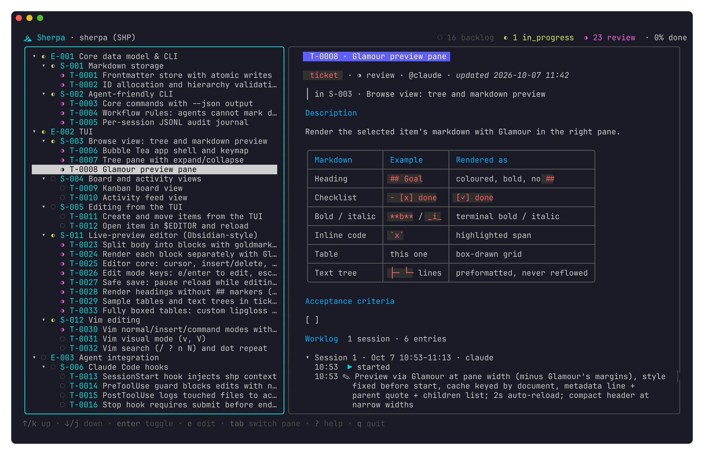
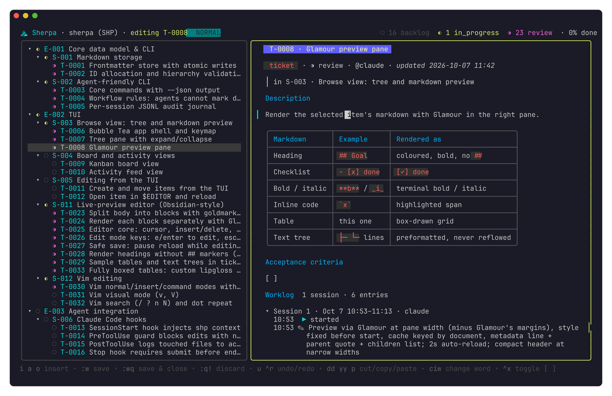

# ⛰ Sherpa

[](https://github.com/RL-Charles/sherpa/actions/workflows/ci.yml)
[](LICENSE)
[](https://pkg.go.dev/github.com/RL-Charles/sherpa)

**A terminal ticket system for you and your coding agents.**
Epics, stories and tickets live as markdown files in your repo. You browse and edit them in a TUI;
agents claim, log and submit work from the CLI. Every step lands in an audit trail, so you always
know what was done, by whom, and against which commit.



## Features

- **Plain markdown in git.** One `.md` file per item under `.sherpa/`. Diff, review and merge it like code.
- **Epic → story → ticket.** A tree view with live status, progress and colour.
- **Rendered markdown.** Headings, checklists, code, text trees and fully boxed tables, right in the terminal.
- **Obsidian-style editing, with vim keys.** Press `e`: the block under your cursor turns into raw markdown and everything else stays rendered.
- **Built for agents.** Agents claim tickets, log typed entries and submit with how the work was verified. A ticket can close when its deliverables and checks are complete; stories and epics need human approval.
- **A readable worklog.** Generated from the journal and grouped into work sessions, with commit ranges and line counts.
- **Live.** The TUI picks up agent activity every two seconds.



## Install

**Binaries:** download the archive for your platform from
[Releases](https://github.com/RL-Charles/sherpa/releases), unpack it and put `shp` and `sherpa`
on your `PATH`. Linux, macOS and Windows builds are available for amd64 and arm64.

**With Go** (1.27 or later):

```bash
go install github.com/RL-Charles/sherpa/cmd/shp@latest github.com/RL-Charles/sherpa/cmd/sherpa@latest
```

This installs the same program under two names: `sherpa` for people, and `shp`, the short form
agents, hooks and docs use. Use whichever you like.

## Quick start

```bash
cd your-project
shp init --key APP                                   # creates .sherpa/
shp new epic "Auth" -g "Email + password login" -g "Token refresh"   # ≥2 goal bullets
shp new story "Login" -p E-001
shp new ticket "JWT refresh" -p S-001 --template feature \
  -m "Rotate tokens on expiry" --deliverable "Refresh accepts an expired access token"
shp                                                  # open the TUI
```

### In the TUI

| Key | Action |
| --- | --- |
| `j` `k` / arrows | Move |
| `/` | Fuzzy search: ID, title, label, `@assignee`, deliverable or code symbol/file; `is:ready`, `is:story` filter; enter jumps there |
| `h` `l` / `enter` | Collapse, expand, toggle |
| `tab` | Switch between tree and preview |
| `e` | Edit the selected item (vim keys: `i` insert, `:wq` save & close, `:q!` discard) |
| `s` | Set the selected item's status (←/→ + enter, or `1`–`6`) |
| `b` | Switch between the tree and the board (tickets grouped by status) |
| `n` | Needs you: the review queues, ✋ manual checks first; `a` approves (done), `x` sends back with a note |
| `w` | Show every worklog session |
| `v` | Cycle tree density: minimal, compact (checks, age, PR), labelled (status word, assignee) |
| `?` / `q` | Help / quit |

The mouse works too. Click a row to select it; click its arrow, or click it again, to expand or collapse it.
Click text in the preview to start editing with the cursor there, and click a worklog session header to show every session.

The preview keeps the ticket's title, status, age, parent and check count pinned while the body scrolls,
and caps prose at a comfortable reading width. Section headings get a rule so a long ticket has
visible landmarks.

With hooks installed (`shp hooks install`), a spinner replaces a ticket's status glyph while an agent is working on it,
and on its story and epic, so it shows even when they are collapsed. The header shows who (`⠹ claude on T-0009`). It stops when the agent's turn ends or it submits.

### From the CLI

```bash
shp ls                     # tree of everything
shp search oauth login     # fuzzy search (also: shp search 30, is:ready, @claude)
shp context                # what's active, in flight, ready and in review
shp show T-0001            # one item, rendered, with its worklog
shp brief T-0001           # compact handoff: outcome, deliverables, next check, code map
shp start T-0001           # claim it and open a work session
shp log "Add refresh endpoint" -f api/auth.go
shp log -k decision "Rotate on use, not on a timer" -d "Simpler revocation"
shp submit -m "Refresh endpoint" --verified "go test ./auth"   # agents → agent review
shp review T-0001 --pass -m "Checked diff and tests"           # agent review → review (--reject: back to in progress)
shp done T-0001            # tickets: agents when deliverables + checks are complete
shp activity               # audit trail across all items
```

Every command accepts `--json`.

## Working with agents

Add this to your agent instructions (`CLAUDE.md`, `AGENTS.md`, …):

```markdown
## Work protocol
1. `shp context` to see what to work on.
2. `shp start <T-id>` before editing code. If no ticket fits, create one: `shp new ticket "…" -p S-xxx --template feature`.
3. Pin the brief before the diff: `shp deliverable add "outcome"`, `shp where add path --symbols Type,Func --deliverable 1`, and `shp check add --for 1 "unit: go test ./…"`.
4. Log as you go: `shp log "headline" -f file`, or `-k decision` / `-k verify` / `-k blocker`, with `-d` for details.
5. Run `shp lint <T-id>`; fix missing context, deliverables, evidence or code-map entries.
6. Finish with `shp submit -m "what changed" --verified "how it was checked"`. It lands in agent review.
7. When asked to review agent work: `shp review <id> --pass -m "…"` (on to human review) or `--reject -m "…"`.
8. Close a ticket when every deliverable and check is resolved: `shp done <T-id>` (no human approval needed). Stories and epics are closed by a human after review; agents cannot close them.
```

Tickets close on evidence, not on a click: once a ticket has been submitted and every deliverable
and check is resolved, an agent may run `shp done <T-id>`. No approver is required. Agent review
and `shp review` remain available for a second look, and a human can close at any time.

Stories and epics are different: only a human can close them, after reviewing the work beneath
them. Agents cannot close a story or epic, even with `--approved-by`.

The session that submitted the work can't review it. To have another agent do it automatically,
configure a reviewer: a shell command that reads the review prompt on stdin.

```yaml
# .sherpa/config.yaml
reviewer:
  command: claude -p --allowedTools "Bash(shp:*)" "Bash(git:*)" "Bash(go test:*)" Read Grep Glob
  auto: true   # launch after every agent submit; otherwise `shp review <id> --spawn`
```

The reviewer runs detached as `agent:reviewer` in its own session, logs to
`.sherpa/.local/reviews/<id>.log`, and ends with `shp review --pass` or `--reject`.

Low-risk tickets can still be closed by a passing agent review. `.sherpa/policy.yaml` lists which
ones; anything with an unresolved deliverable or check still goes to a human. `shp policy <id>`
explains the decision.

```yaml
auto_done:
  - name: docs
    labels: [docs, tests]
  - name: tooling
    under: [S-008]
    max_lines: 200
```

Some checks only a human can make (how it looks, how it feels, a real device). Agents add them with
`shp check add --manual "…" --how "steps"`; they show as ✋, and only humans tick them. An agent
cannot close a ticket while a manual check is open.

Sherpa enforces the important parts: agents can't log to a ticket they haven't claimed, can't
submit without saying how the work was verified, can't close a ticket with an open deliverable or
check, and can't close a story or epic at all. Claude Code is
detected automatically (`CLAUDECODE=1`); for other agents, set `SHERPA_ACTOR=agent:<name>`.

Agents working in git worktrees (`git worktree add`, Claude Code's `.claude/worktrees/`) all
read and write the main checkout's `.sherpa/`, so the board shows their progress live; set
`SHERPA_DIR` to point somewhere else.

## Readable tickets

Agents keep structured data current with commands, so ticket prose stays human-written and
every ticket reads the same way:

```text
T-0030 · Add OAuth login
● done · ⇡ PR #35 merged · +412 −37 · checks 2/2 ✓ · deliverables 2/2 · 4 files · needs T-0019 ●
Now: …one line on where things stand…
Why / Context / Design …          ← human prose: problem, constraints, types/enums, patterns, invariants, edge cases
Visual                            ← stories and epics: generated from children until you draw one
Deliverables · 2/2                ← outcomes; each check nests under the deliverable it proves
Where                             ← code map: file · change · symbols · state · which deliverable
Measurables                       ← boxed table: measure · target · current ✓/✗ · evidence
Work done                         ← PR, branch, size, commits (linked automatically)
Other checks                      ← only checks not linked to a deliverable (omitted when empty)
Worklog                           ← highlights; routine progress folds away (w shows all)
```

| Command | Does |
| --- | --- |
| `shp new ticket … --template feature` | Scaffold Why / Context / Design (types, enums, patterns, invariants, contracts, edge cases) / Out of scope / Risks. Also `bug`, `spike`, `chore` |
| `shp design <id> --stdin` | Set just the Design section: shape, types/enums, pattern, invariants, contracts, edge cases, alternatives |
| `shp deliverable add "outcome"` · `done <n> -e <ref>` · `list` | Outcomes the ticket promises; separate from how they are proven |
| `shp where add <path> --symbols Type,Func --deliverable 1` | The code map: files, symbols, change type and the deliverable each serves |
| `shp check add --for 1 "unit: go test ./…"` | A check that proves deliverable 1 |
| `shp lint [id]` | Warn about missing Why/Context/Design, deliverables without checks, ticked checks without evidence, stale placeholders and missing code maps (`--strict` for CI) |
| `shp brief [id]` | Compact outcome, deliverables, next check, code map and authored context — the handoff for an agent or reviewer |
| `shp migrate brief [id…]` | Preview/apply the mechanical part of the new brief to existing tickets (deliverables, code map, template, Now, Description→Why) |
| `shp now "…"` | One-line current state at the top |
| `shp check <n> -e <sha\|PR\|path>` · `shp checks` | Acceptance checks with evidence (`--waive`, `--undo`) |
| `shp measure "<name>" <value> --target <goal> -e <ref>` | Rows of the Measurables table; ✓ when the target is met |
| `shp visual <S-id> --stdin` · `--auto` | A story/epic diagram; `--auto` prints the generated one |
| `shp depends <id> <dep…>` | Dependencies, shown as badges and in Visuals |
| `shp sync` | Link PRs (by branch or title, e.g. `app-30-…`, `T-0030`) and `Ticket:` commits; refresh PR state |

Agents open PRs with `gh pr create`; the hooks catch the URL and link it to the active ticket.
`shp submit` looks up the branch's PR and **warns** about a missing PR, open checks, unmet
measures, deliverables without checks, a missing code map or a missing Now line. Tickets in review
show a review card with the summary, verification, follow-ups and those warnings.

The distinction that keeps tickets clear: **a deliverable is an outcome you can show someone**
("the client retries once on a 401"); **a check is how you prove it** ("two expiries, no redirect").
`Where` is the intentional change map, written before the diff and reconciled afterwards.

`shp brief` is the compact handoff: outcome, deliverables, next open check, code map and the
authored context/design, with gaps called out. `shp show` remains the full document.

### Upgrading existing tickets

Old tickets can gain the structure without a bulk prose rewrite:

```bash
shp migrate brief T-0046                 # preview: what can be recovered
shp migrate brief T-0046 --deliverable-from-title --normalize-description --write
shp migrate brief --all                  # preview the whole repo
shp migrate brief --all --write          # apply mechanical fields everywhere
```

Preview is the default. `--write` only applies facts the repository already has:

- a deliverable from the ticket title (`--deliverable-from-title`)
- unlinked checks attached to that deliverable (`--link-checks`)
- code-map entries from files recorded by hooks and worklog entries (`--from-history`)
- the template detected from existing sections (`--stamp-template`)
- `Now` from the latest log entry
- `Description` → `Why` when `Why` is missing (`--normalize-description`)

It never writes `Why`, `Context`, `Design` or `Out of scope`. The report lists those as remaining
gaps; `shp lint --strict` is the work queue. That is deliberate: a migration must not invent the
reasoning that makes a ticket worth reading.

`shp migrate` (without `brief`) still moves legacy worklogs out of ticket bodies.

## Hooks: enforcement, not just instructions

`shp hooks install` wires Sherpa into Claude Code, Cursor, Codex and OpenCode (plus a git hook),
so agents can't quietly work untracked:

| When | What happens |
| --- | --- |
| Session starts | The agent is told what's active, in progress and ready; for the active ticket it gets the deliverables, open checks and code-map paths |
| Before an edit | Blocked until a ticket is claimed (`shp start`), with instructions to fix it |
| After an edit | The file is recorded on the ticket ("files touched", diff stats) |
| Agent stops | Asked once to `shp log` or `shp submit` if files changed since the last entry |
| `git commit` | `Ticket: T-xxxx` added from the claimed ticket; agent commits without one are refused |

| Agent | Installed into | Notes |
| --- | --- | --- |
| Claude Code | `.claude/settings.json` | SessionStart, PreToolUse, PostToolUse, Stop |
| Cursor (IDE and `cursor-agent`) | `.cursor/hooks.json` | sessionStart, preToolUse, afterFileEdit, stop |
| Codex CLI ≥ 0.124 | `.codex/hooks.json` | Trust the project and approve the hooks in `/hooks` |
| OpenCode | `.opencode/plugins/sherpa.ts` | Plugin calls `shp hook … --agent opencode` |

Hooks fail open: if `shp` isn't installed or a repo has no `.sherpa/`, nothing is blocked.
`shp hooks status` shows what's installed; `shp hooks uninstall` removes only Sherpa's entries.
The active ticket is tracked per checkout, so run one agent per checkout (use worktrees for parallel agents).

## Importing from Agency

`shp import agency --mapping layout.yaml` converts `.agency/issues/` into epics, stories and
tickets. The mapping places every issue in a story; ticket numbers match issue numbers, comments
become worklog entries, and the originals are archived in `.sherpa/imports/agency/`.
Run `shp import agency --help` for the mapping format.

## How it's stored

```text
.sherpa/
├─ config.yaml          # project key and name
├─ epics/E-001.md       # YAML frontmatter + markdown body
├─ stories/S-001.md     # parent: E-001
├─ tickets/T-0001.md    # parent: S-001
└─ sessions/*.jsonl     # append-only journal; the worklog is built from it
```

## Status

Early and moving fast. Sherpa tracks its own development: clone this repo and run `shp` inside it
to browse the roadmap, from Claude Code hooks and an MCP server to the kanban board and vim visual mode.

## Build from source

```bash
git clone https://github.com/RL-Charles/sherpa && cd sherpa
go build -o bin/ ./cmd/...      # bin/shp and bin/sherpa
go test ./...
```

## Contributing

Issues and pull requests are welcome. Read [CONTRIBUTING.md](CONTRIBUTING.md) for setup and checks,
and the [Code of Conduct](CODE_OF_CONDUCT.md). Report security problems privately as described in
[SECURITY.md](SECURITY.md). Changes are listed in [CHANGELOG.md](CHANGELOG.md).

Agent hooks run as POSIX shell commands; on Windows use Git Bash or WSL for them.

## License

Sherpa is released under the [MIT License](LICENSE).
